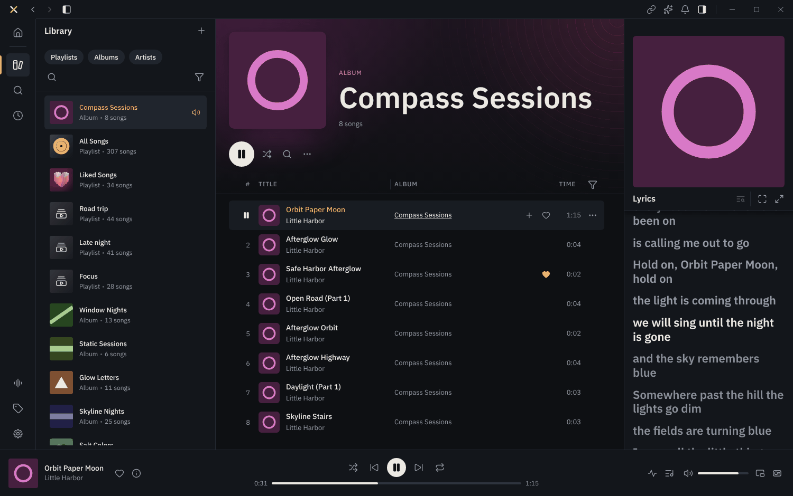
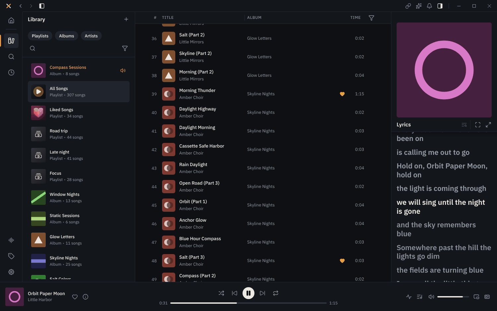
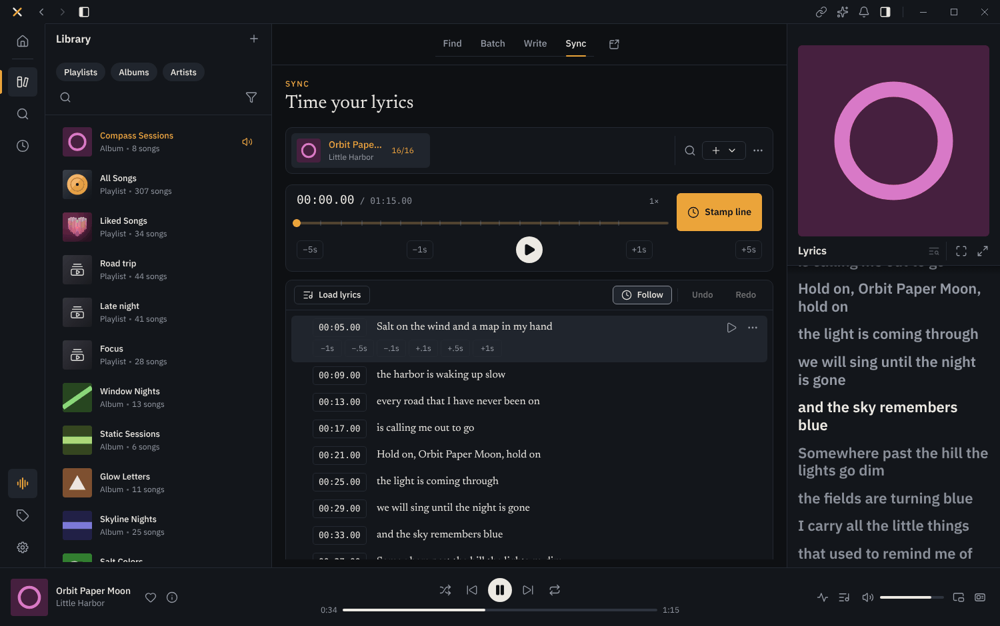
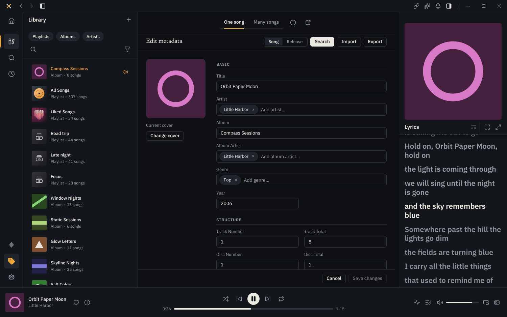
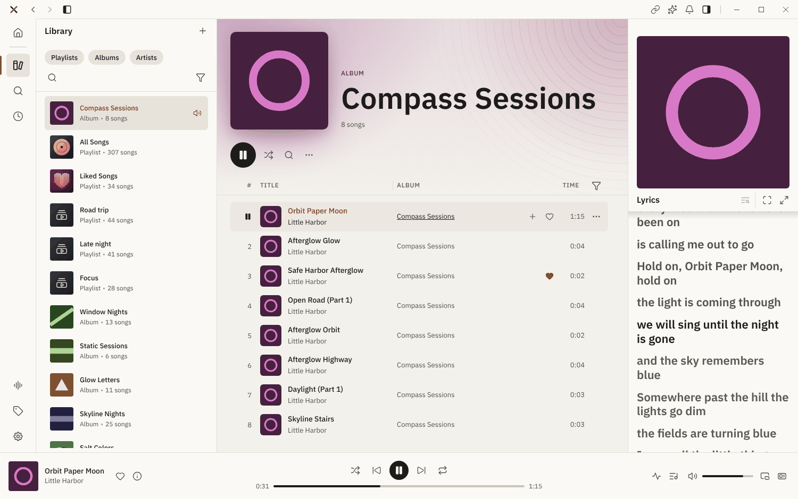

# Xplayer

A free, local-first music player for Windows. Point it at your music folders and get gapless playback, synced lyrics, a tag editor and optional online lookups. No account, no ads, no tracking.

> **Pre-release (1.0.0-beta.1).** Windows 10 and 11, 64-bit. It is usable and has rough edges: see [`docs/KNOWN-PROBLEMS.md`](docs/KNOWN-PROBLEMS.md).







*The screenshots use the built-in sample library (`npm start -- --profile=sample`): made-up songs, drawn covers and lyrics written for it.*

## Features

- **Library:** folders are scanned in the background. Browse songs, albums, artists, playlists, folders, favorites and history, and search them. Playlists, playlist folders, automatic backups of the library file, and library health checks (beta).
- **Playback:** gapless and crossfade, a seek bar with a waveform, an equalizer, a visualizer, a queue, shuffle (Smart Shuffle is beta), Mini Player and Quick Player windows, play from a URL, and open files from Explorer.
- **Lyrics:** plain and synced. A sync editor, and online lookup ([LRCLIB](https://lrclib.net)) for one song or many.
- **Tags:** edit tags and covers for MP3, FLAC, OGG, Opus and M4A, one song or many, with undo. Look up tags online ([MusicBrainz](https://musicbrainz.org)).
- **AI (optional, off until you accept the privacy screen):** uses your own [OpenRouter](https://openrouter.ai) key to organise the library, build playlists, suggest tags and translate lyrics. Every change is shown first and can be undone.

## Install

Download a file from the **Releases** page (builds marked *Pre-release* are early):

- **Installer** (`Xplayer-Setup-<version>-x64.exe`): no administrator needed. Data is in `%APPDATA%\Xplayer`; uninstalling asks before deleting it.
- **Portable** (`Xplayer-<version>-win-x64.zip`): unzip anywhere and run `Xplayer.exe`. Data is in `Xplayer-Data` next to it.

The builds are not signed, so SmartScreen may warn: choose **More info**, then **Run anyway**. `SHA256SUMS.txt` on each release lists the hashes; check yours with `certutil -hashfile <file> SHA256`.

To update, run the new installer over the old one, or replace the portable folder and keep `Xplayer-Data`. **Settings > Data > About > Check for updates** says whether a newer release exists.

If something goes wrong, use **Settings > Data > Diagnostics > Copy diagnostics** and paste the result into an [issue](https://github.com/ExhataQ/Xplayer/issues). It has the version and recent log lines with file paths removed, and no song names or keys.

## Privacy

Your library stays on your computer. Nothing is sent until you use a feature that needs the internet: lyrics and tag lookup, Play from URL, Check for updates, the optional AI. There is no account, analytics or crash reporting. [`docs/PRIVACY.md`](docs/PRIVACY.md) lists what each feature sends.

## Build from source

Needs Node.js 22 or newer.

```powershell
npm install
npm start                       # run from source (data in .dev-data/)
npm run dev                     # DevTools, reload on a change in src/, restart on a change in electron/
npm start -- --profile=sample   # a made-up library of 300 songs
npm run lint                    # lint the application source
npm run dist                    # portable app: dist/Xplayer/ and dist/Xplayer.zip
npm run dist:installer          # installer
```

See [`docs/DEVELOPMENT.md`](docs/DEVELOPMENT.md), [`docs/ARCHITECTURE.md`](docs/ARCHITECTURE.md) and [`docs/RELEASING.md`](docs/RELEASING.md).

## Contributing

Issues and pull requests are welcome. Keep changes focused, run `npm run lint`, and add a line to `CHANGELOG.md` under "Unreleased" for anything a user would notice. The automated test suite is not included in this public beta snapshot. To report a security problem privately, see [`SECURITY.md`](SECURITY.md).

## License

ISC (`LICENSE`). The packages and assets in a build, with their licenses, are listed in `THIRD-PARTY-NOTICES.txt` (made by `npm run notices`). Some dependencies are under the LGPL and stay as separate, replaceable files in the build.
